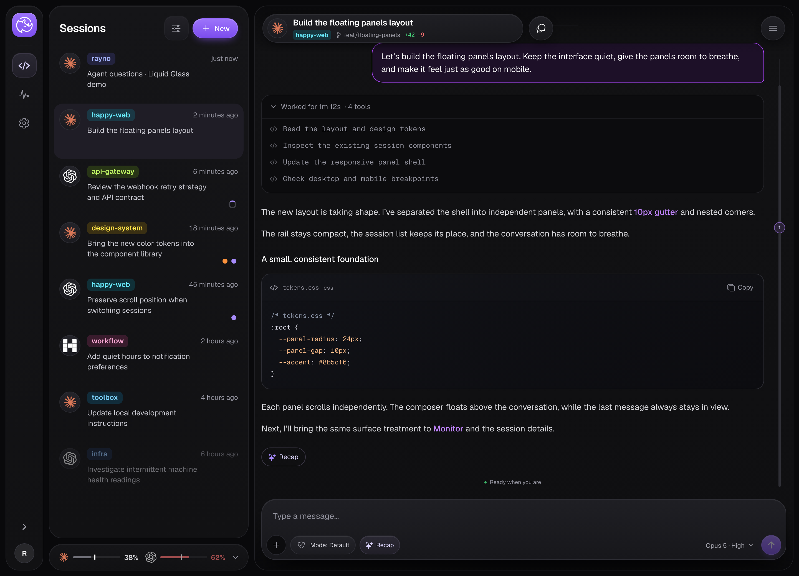
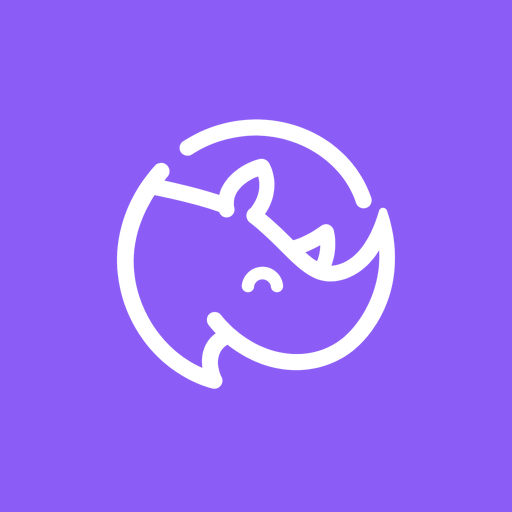

<p align="center">
  
</p>

<h1 align="center">Rayno</h1>

<p align="center">A static web client for your own Happy CLI agents.</p>

## Quick start

You need a Mac with Node.js 24 and pnpm.
You also need Claude Code or Codex, signed in on the same Mac.

[Tailscale](https://tailscale.com) with HTTPS certificates turned on is optional.
With it, your server gets an HTTPS address that works on all of your devices.
Without it, the server address is `http://127.0.0.1:3007`, and it works only in a browser on that Mac.

### 1. Install your own Happy server

Run this command in a terminal:

```bash
git clone https://github.com/yingray/happy.git ~/happy && ~/happy/.rayno/install.sh
```

The script starts a Happy server and links the Happy CLI to it.
On a new Mac, it also makes a Happy account and signs the CLI in.
At the end, it prints two values: your **Happy server** address and your **recovery key**.
The server address is your Tailscale address when Tailscale is ready, and `127.0.0.1` when it is not.

> [!WARNING]
> Save the recovery key when the script shows it. It is your account, and the script shows it only once.
> Anyone with the key can read all of your sessions.

### 2. Sign in to Rayno

Go to https://rayno-co6.pages.dev.
Paste the **Happy server** address and the **recovery key**, then select **Connect account**.

Chrome asks to let the site access devices on your local network, because your server is on your own network.
Select **Allow**. Safari does not ask.

Rayno keeps the key in this browser only when **Remember this login on this device** is selected.

### 3. Start an agent

Go to a project folder and start an agent:

```bash
happy claude   # or: happy codex
```

Your sessions now show in Rayno.

### Use an existing Happy account

If you already use Happy, enter your Happy server in the **Happy server** field.
For the hosted Happy server, enter `https://api.cluster-fluster.com`. The field has no default value.
To get your recovery key, open the Happy app and go to **Settings → Account → Secret Key**.

## About the name

Rayno comes from "Ray no Happy CLI". "no" is the Japanese particle の, so the phrase means "Ray's Happy CLI".
The initials R and H turn it into RHino, the rhino in the logo. Rayno is the same word, spelled after "Ray no".

Rayno began as a personal patch of the Happy web app. It is now a separate product with its own code.

## What it is

Rayno is a static web client for [Happy](https://github.com/slopus/happy).
It is written in React, TypeScript, and Vite.
Rayno owns its UI, dependencies, authentication, encryption, realtime client, build, and browser storage.
Session traffic goes to the Happy server. The Happy CLI daemon on your computer connects to the same server.
Recap cloud speech sends only the selected summary to the same-origin Pages Function and Microsoft Edge read-aloud service.
The server relays end-to-end encrypted session data and RPC calls between them.

## How it connects

```text
browser (Rayno) ──HTTPS/WSS──▶ Happy server ◀──── Happy CLI daemon on your computer
```

Rayno does not connect to your computer directly.
The "host" on the login screen is the Happy server that your CLI uses.
The login screen has no default host. For the hosted Happy server, enter `https://api.cluster-fluster.com`.
If you run your own Happy server, it must use HTTPS and allow CORS from the Rayno origin. A server on the same computer can also use `http://127.0.0.1`.

## Sign in

The login screen shows the install command, with a copy button, and a sign-in form with two fields:

- **Happy server**: the HTTPS origin of the Happy server that your CLI uses.
- **Recovery key**: your Happy account recovery key. The key is the 32-byte account secret.
  Rayno accepts the grouped base32 form that the installer and the Happy app show, and the base64 form.

The address is checked when the field loses focus, when you press Enter, or when you connect.
Rayno does not send requests to a partial address while you type.
An HTTP address is rejected, except for `localhost`.

With **Remember** selected, the token, the account secret, and the server address stay in this origin's `localStorage`.
Sign-out clears the token, the secret, drafts, pending packets, and the offline cache.
The server address stays, so the next login starts with the same server.
Without **Remember**, the login stays in this tab's session storage and the server address is not saved.
Anyone with access to this browser profile can read a remembered secret.

Server changes synchronize across clients. Rename, archive, and delete affect the shared session.
Restore removes the archive marker. It does not start an offline agent.
The default list hides explicitly archived sessions and ended CLI sessions, as the Happy app does.
Open the list options button above the list and choose Archived to read their history. A disconnected Rig session stays visible.
The same glass menu contains search, Flat/Projects grouping, and Reset. Command/Ctrl+K opens it and focuses search.
An ended CLI session has no archive or restore action in Rayno.
Use Resume session when the original computer is online and its daemon advertises recovery support. Otherwise use Hand Off to start a new session.
Archived Claude and Codex sessions show Resume even when the server still reports them as active. The owning daemon checks for an existing process.

## Connected features

The [Happy Web gap tracker](docs/happy-web-gap-tracker.md) lists every audited item, its status, evidence, and remaining limits.

- Paginated session lists and encrypted message history, with earlier-message loading.
  After the first complete read, a refresh reads only the sessions that changed. A reconnect or a manual retry reads the complete list again.
- An encrypted local session list and previously loaded chat pages that remain readable after an offline reload.
- Encrypted sends with stable local IDs, explicit acknowledgement, retained failed drafts, and deduplicated retries.
- Socket.IO updates and history catch-up after reconnect. Background tabs announce background state.
- Legacy NaCl records and per-record AES-GCM keys, with account key derivation and key unwrap.
- Stop the current response, terminate an agent, and allow a tool once or for the session.
- Answer agent question forms and Claude AskUserQuestion inside the matching tool activity, with a fallback for unloaded calls.
- Upload encrypted PNG, JPEG, GIF, and WebP images in chat or a new session; open received images and download a decrypted copy. Each message accepts up to 20 images, smaller than 10 MB each.
- Open local image paths in agent replies with **Load private image**. Rayno reads the image through the session's encrypted RPC and saves an encrypted attachment. It creates no public link. Local imports support PNG, JPEG, GIF, and WebP files up to 4 MB inside the session workspace. Saved imports remain available after reload and, once cached, offline.
- Expand tool calls to read arguments and results, including original file source, verified raster images, and complete reported diffs.
- Read denied or canceled command decisions even when the agent never emitted a tool call.
- Keep subagent work under its parent across message pages and offline reloads. Unplaced work stays readable without main reply actions.
- Spawn a real agent on an online machine, including optional Git worktree creation.
- Hand Off from Session info or the chat menu to an editable new-session draft on the same computer and checkout.
- Choose DiceBear Planets in Settings > Appearance > Avatar style for a fixed planet per session ID. The list, chat header, and Session Info share the same locally generated SVG; no session ID goes to an avatar service. Agent choices without a session keep provider marks.
- Choose Standard or Intense glass in Settings > Appearance. Intense adds translucent panels, frosted floating controls, menus and dialogs, stronger edge highlights, and static colored light behind the workspace. It preserves the standard layout and saves the choice in Rayno on this device.
- A conversation and composer with full, moderate, and standard width choices in Settings > Appearance. Moderate width is the default.
- Resize the boundary beside Side Chat or Session Info on screens at least 1280px wide. Side Chat supports 360–720px and Session Info supports 320–560px, while the main conversation retains at least 520px. Drag the divider or use arrow keys; double-click or press Enter to reset. Each panel remembers its width in Rayno on this device.
- The navigation shows an Updates icon only when a newer release is available. A new release opens a dismissible prompt; reloading requires an explicit click. Background checks run every five minutes while visible and online, and when returning to Rayno. The Sessions icon shows a dot for unread main-session replies, without a count. Phone navigation has the same indicators.
- Each formal agent response starts with a thin divider and its original date/time in your local time zone. Tool activity and reasoning keep their existing grouping; missing legacy timestamps show as unavailable.
- The floating chat header includes session actions, Hand Off, and a new session in the same workspace.
- Soft dark gradients at the message viewport's top and bottom, below the floating controls.
- Mermaid code fences render with `beautiful-mermaid`, with source copying, scrollable diagrams, and readable source when a preview is unavailable.
- Fenced code blocks show local syntax highlighting, a language label, and source copying. Unknown languages keep their plain source.
- Searchable model/effort selection with visible Claude and Codex choices.
- Recent workspace selection from real session activity and Rayno's own per-computer history.
- A chat-header menu provides archive, delete, Fork, and Duplicate. Fork copies the full provider conversation; Duplicate lets you choose the final message to keep. Both create a new session on the original computer with explicit model, effort, and permission choices.
- Rename with optimistic concurrency, archive, restore, and delete with server error handling.
- Read-only directory and file previews, Git status, and staged/unstaged diffs through the session RPC.
- Computer health and Claude/Codex quota reads on explicit Monitor refresh.
- Rename a computer, stop its daemon, or remove it from the account with confirmation. Removal preserves conversations.
- Read historical tokens and reported USD cost by period, session, model, and date in Settings > Usage.
- Select English or Traditional Chinese, keep reported context visible, and save an exact custom Codex model ID in Settings > Advanced.
- Use the desktop reading rail to jump to each formal response, including responses without a recap. Unnumbered dots show all loaded replies in a compact overview. When they overflow, the independently scrollable dot list follows chat progress and reaches its latest end when the chat reaches the bottom. Small, medium, and large dots represent fewer than 500, 500–1,999, and at least 2,000 visible non-whitespace characters.
- Agent icons identify the compact weekly-usage bars and retain accessible names.
- Independent appearance preferences, drafts, recent folders, responsive panels, and keyboard navigation. The composer warns when 10% or less of the context window remains. Advanced settings can keep the reading visible; Model & effort also shows it.

Existing sessions prefer the daemon's model catalog. New sessions offer agent, model, effort, and permission mode selection before Start.
Permission mode always has a selected value. It restores the last explicit choice for that agent from a new session or chat, or selects Yolo without a valid choice.
The spawn request, first encrypted message, and chat controls use the selected mode.
Known current provider, permission, model, and effort fields remain in outbound messages.
Unavailable battery, network, latency, or quota data never falls back to samples.
Monitor usage reads do not send an AI prompt or start a model turn.
While this Rayno tab is visible and focused, usage refreshes once per minute on every route.
Background or unfocused tabs stop polling. Offline computers receive no reads, and overlapping refreshes share one request.
Each online computer runs one quota query per cycle, with short-lived Claude SDK and Codex app-server processes.

The app opens saved content while it reads current data. Normal startup has no yellow connection warning.
A failed workspace or realtime connection shows a warning with Retry; an active retry hides the warning.
Known offline use shows a quiet status beside the list and conversation instead.
Reconnect merges missed replies with saved pages. An offline draft stays local and is not sent automatically.
Message-read failures stay inside the conversation, with a retry for the failed page and optional technical details.
File and Git views wait for the realtime connection before they read the computer.

The offline cache uses IndexedDB on this Rayno origin, encrypted with the current account key.
Its keys include the account and server scope. It does not cache authentication headers or private API responses in the service worker.
Only loaded message pages are available offline; unseen conversations explain how to save their content.
The diagram renderer loads only when a Mermaid preview comes into view. Once loaded, the service worker caches its static code for offline previews.
Diagram layout runs in a Web Worker, and SVG images stay outside the page's executable markup.
Browser storage availability and eviction can affect saved content. A cache failure does not replace live data with demo data.

Voice, push notifications, and general file uploads are not implemented. Image uploads use the Happy API and its local PUT or S3 POST storage contract. The storage service must allow this Rayno origin through CORS.
Failed image uploads retain the draft and attachments. Retrying a send with no confirmation reuses the encrypted message IDs. Selected image files remain in memory and must be selected again after a reload.
Received images load when they enter the viewport. Rayno stores verified images in the encrypted account/server cache so they can reopen after an offline reload. Browser quotas and eviction can affect availability. Sign-out clears this cache.
Session recovery supports Claude and Codex on the original online computer. Old daemons and sessions without a provider recovery ID show the reason recovery is unavailable. The account master secret never enters a resume request.
Preview supports UTF-8 files up to 1 MB. Files and Git commands require daemon support.
The app reports unsupported or failed operations instead of substituting local results.

A legacy spawn timeout has no safe automatic retry ID.
Rayno asks you to check the Happy app before you repeat that draft.
Happy Agent is hidden from creation and agent-switch controls. Existing sessions remain readable.
A failed initial send retains the new session ID so a retry does not spawn another agent.

Hand Off selects Codex for a Claude session and Claude for a Codex session.
It fills the prompt with the old Happy session ID and the provider's local transcript path, when available.
The cursor starts at the end so that you can add instructions. Start launches the new agent.
For a Happy worktree, the draft retains the repository and the exact existing checkout path.
The worktree picker accepts a branch name for a new checkout or an absolute path for an existing checkout.
Model and supported effort controls always select a concrete value. They restore the last valid choice for that agent.
When no saved choice is available, Rayno selects a concrete model from the catalog and a supported effort.
New sessions, same-workspace drafts, and handoffs share these Rayno account preferences. They do not use an agent-default alias.
Existing chats keep their explicit per-session choices. Later model changes also update the preference for future sessions.
The workspace picker groups recent folders by computer, merges duplicate paths, and preserves the selected worktree.
Successful starts save the workspace in this Rayno account's browser storage, including when the session later disappears.

## Explicit demo mode

Use Explore the demo on the login screen, or Settings > Developer > Open demo.
Demo mode uses a separate `rayno.demo.v1` schema store and simulated replies.
That key's `v1` is a data schema version, not the frontend version.
Demo computers, files, usage, and attachment names stay separate from real account data.
Use Settings > Account > Connect to Happy to return to the connected client.
Reset demo affects only demo data.

Open `/session/git-diff-demo/changes?demo=1` to try the Git diff viewer.
Select files and compare working tree or staged changes in unified or split views.
Sample files include binary and rename changes. Use the state selector to try clean, conflict, and read-error states.
This demo uses sample data. The connected view reads Git through the session CLI and does not change the repository.

Open `/session/tool-timeline-demo?demo=1` to try the tool activity ticker and timeline.
Select Start demo, then Next step to advance the simulated tools. Expand the activity to inspect each result.
Select Finish demo to see the duration summary. Select Restart demo to repeat the example and keep your draft.

Open `/session/private-image-demo?demo=1` on your Rayno server to try the image preview.
Select **Load private image**, then select the thumbnail to open or download it.
This demo encrypts and decrypts the public README screenshot in this browser. It reads no computer file and uploads no attachment.
Reload the page to repeat the demo.

## Local development

Use Node.js 22.12 or newer and pnpm 11.10.0. `.nvmrc` pins Node.js 24.16.0.

```sh
pnpm install --frozen-lockfile
pnpm dev       # http://127.0.0.1:5180
pnpm build
pnpm preview   # production preview, http://127.0.0.1:5179
pnpm serve     # production preview, http://127.0.0.1:5178
```

The servers listen on loopback only.
To open them from another device, put a proxy in front, for example `tailscale serve`:

```sh
tailscale serve --bg --https=5180 http://127.0.0.1:5180
```

Vite accepts only known host names. Add the proxy's host name to `.env.local`:

```sh
RAYNO_ALLOWED_HOSTS=your-machine.your-tailnet.ts.net
```

`.env.local` stays out of git. `.env.example` lists the supported variables.
Each origin has its own login and browser storage.

### React Compiler

React Compiler runs in development and production builds through the official Babel plugin and Vite's `reactCompilerPreset`.
It targets React 19. Keep existing `memo`, `useMemo`, and `useCallback` calls during adoption.
The compiler can skip components or hooks that it cannot safely optimize.

For a comparison build without the compiler, run `RAYNO_REACT_COMPILER=0 pnpm build`.
Run `pnpm build` again to restore the default compiled build before delivery.
Use the same browser scenarios for both builds; see [the performance plan](PERFORMANCE-PLAN.md).
Open `/reports/react-compiler.html` on your Rayno server to read the paired A/B report and download its raw measurements without signing in.
The [paired probe](benchmarks/README.md#paired-react-compiler-probe) separates React render CPU from normal production response timing.
Open `/session/reply-options-demo?demo=1` on your Rayno server to test the same compiled components as live chats.

## Recap cloud speech

On Cloudflare Pages, Recap uses the same-origin `/api/tts` Function for cloud speech.
Traditional Chinese uses `zh-TW-HsiaoChenNeural`, Simplified Chinese uses `zh-CN-XiaoxiaoNeural`,
and English uses `en-US-AriaNeural`. No model loads in the browser.
The Function uses the current Edge read-aloud protocol, including the v2 handshake token.
This community protocol can change; it is not a paid Microsoft speech API with a service guarantee.

Only Recap text leaves the browser for speech. The Function does not receive the full reply, tool logs,
Happy credentials, or account keys. It does not log text or save text or audio in Cloudflare storage.
The response contains short MP3 audio and word timings so the existing highlight can follow playback.
The current player keeps its audio after playback ends, so Play restarts it immediately without another request.
Pause and speed changes also reuse that audio. Stop, navigation, and backgrounding release the player's URL.

For signed-in accounts, the Service Worker keeps a separate encrypted audio cache for 24 hours from synthesis.
Replaying does not extend the expiry. Reloads and offline playback can use the same cached MP3 and word timings.
The cache separates accounts and Happy servers; keyed content hashes also separate text, language, and voice versions.
The worker receives ciphertext only, without recap text, account keys, or raw audio. Sign-out removes that account's entries.
Expired entries are never used and are removed on access or worker activation. The cache holds at most 64 entries or 32 MiB,
with the oldest entries removed when the budget is full. Storage denial does not block online playback.

Cloud failure or offline use falls back to the browser voice when available.
A static host without the Function keeps browser speech. If neither voice works, Recap shows a retryable notice.

The relay uses the Workers Free plan without paid bindings, R2, D1, or KV. Keep the account on the Free plan.
Cloudflare's free request and CPU limits still apply, shared with other Workers in the account.
`public/_routes.json` invokes the Function only for `/api/tts`; static assets and chat routes bypass it.
The endpoint accepts same-origin JSON POSTs, limits text to 1,000 UTF-16 code units and bodies to 8 KiB,
and rejects synthesis responses over 1 MiB. Burst control allows 12 POSTs per minute per IP per isolate;
it is best effort, not an account-wide quota. HTTP responses use `Cache-Control: no-store`.
Text never enters query strings. The initial GET only discovers speech availability.

To test the actual Function locally after a build:

```sh
pnpm dlx wrangler@4 pages dev dist --compatibility-date=2026-10-12 --ip 127.0.0.1 --port 5186
```

Use the existing Tailscale route for the selected local port. A Vite preview serves only static files,
so it uses browser speech. Cloudflare authentication is needed for a production deploy, not local testing.
Git-integrated Pages builds detect `functions/` automatically. For a direct upload, run
`wrangler pages deploy dist` from the repository root so Wrangler also bundles the Function.

## Deploy to Cloudflare Pages

Rayno serves its UI as static files. The optional Recap speech endpoint uses one Pages Function.

| Setting | Value |
| --- | --- |
| Framework preset | None |
| Build command | `pnpm build` |
| Build output directory | `dist` |
| Environment variable | `NODE_VERSION=24.16.0` |
| Environment variable | `PNPM_VERSION=11.10.0` |

The Pages build image does not read the pnpm version from `package.json` or the lockfile, so set `PNPM_VERSION`.
`pnpm build` runs the type check before the Vite build.

`public/_headers` sets the response headers:

- A Content Security Policy. `connect-src` allows any HTTPS and WSS origin, because each user enters a Happy server.
  `'wasm-unsafe-eval'` lets libsodium compile its WebAssembly module.
- A one-year immutable cache for `/assets/*`. Vite adds a content hash to those file names.

Pages has no top-level `404.html` here, so it serves `index.html` for every unknown path.
Routes such as `/session/<id>` work after a reload.
`public/assets/404.html` makes a missing file under `/assets/` return status 404, not `index.html`.
A page from an old release then gets a clear load failure. The screen error clears the shell and reloads once.

Every Pages deployment, including each preview URL, is a separate origin.
Each origin needs its own login.

To check the Pages behavior locally, build and run the Pages emulator:

```sh
pnpm build
pnpm dlx wrangler@4 pages dev dist --ip 127.0.0.1 --port 8788
```

## PWA

The generated manifest identifies Rayno. Its service worker uses a `rayno` cache prefix.
Public service-worker caches contain static assets and the app shell.
Recap audio uses a separate encrypted account cache with a 24-hour expiry.
Raw live API responses and credentials do not enter either cache. Shell updates retain the encrypted Recap cache.
Demo interactions work offline after the shell is cached. Real operations require the Happy server and daemon.
Adapted protocol copies have pinned provenance in `src/happy/PROTOCOL-SOURCES.md` and retain `HAPPY-LICENSE.txt`.

## Checks

```sh
pnpm typecheck
pnpm test
pnpm build
pnpm exec playwright install chromium webkit
pnpm test:e2e
```

Browser tests start an isolated production preview on port 5179.
Stop another local preview there before the test run.
The tests mock the Happy server and use a Vite preview, so they do not apply `public/_headers`.
`MermaidPage.svg()` reads the diagram with `fetch()` on a `blob:` URL. The production CSP blocks that call, so run that test against a Vite preview.
Tests use Page Objects and fresh browser contexts.
Connected tests use encrypted fixtures and mock REST/WebSocket boundaries, with no production writes.
They verify browser compatibility rather than a live daemon deployment.
Every UI change also requires phone interactions at narrow widths, short keyboard heights, and landscape sizes.
Check touch targets and action reachability, in addition to overflow and screenshots.
See `VERIFICATION.md` for results, artifacts, and manual checks.
See `PERFORMANCE.md` for render isolation, lazy modules, and the production benchmark.

## Design and licenses

The implementation follows a design handoff for dimensions, opaque gradients, nested corners, and responsive panels.
Chromium and WebKit emulation do not verify a physical iOS keyboard or an installed iOS PWA.
Fonts and icons remain local.

Rayno uses the MIT license. See `LICENSE`.
Third-party notices are in `THIRD-PARTY-NOTICES.md`, `HAPPY-LICENSE.txt`, and `public/fonts/OFL-Geist.txt`.
Rayno is not affiliated with Happy, Anthropic, or OpenAI.
